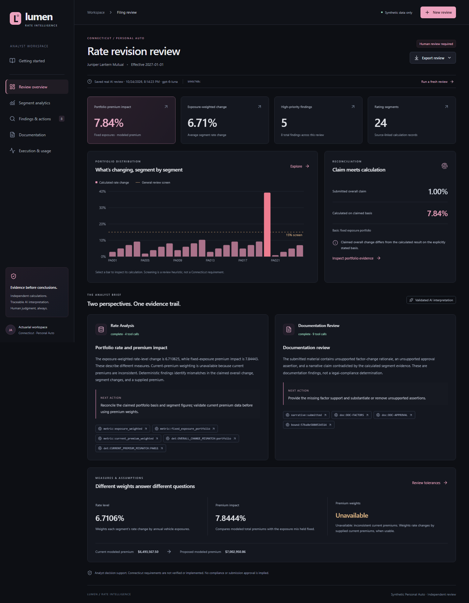

# Lumen · Insurance Rate Filing Assistant

An evidence-led Personal Auto filing workspace for Yale SOM MGT 409. Lumen combines
independent Python calculations, two genuine tool-using AI agents, and a React
analytics dashboard. Connecticut is the initial context; state-specific
requirements have **not** been verified or implemented. All datasets are synthetic.

**Final submission:** [Project report](report.html) · [Presentation](slides.html) ·
[Phase 1–4 evidence](docs/evidence/)

For GitHub reproducibility, publish `Final Project` as the repository root; its
Actions workflow runs keyless offline checks on each push and pull request.



## Use the application

Start with **Explore a filing**. Three built-in examples open saved **real** model
reviews immediately without consuming new tokens. Each displays its original
timestamp and is explicitly labeled. Choose **New review** to run fresh agents or
upload a synthetic filing package.

- **Review overview:** portfolio impact, reported-versus-calculated claim,
  executive agent briefs, evidence links, and distinct weighting measures.
- **Segment analytics:** interactive change/comparison charts, a Python-calculated
  premium-contribution chart, searchable/sortable segment exhibit, territory and
  findings filters, and source-row links.
- **Findings & actions:** severity/origin filters, numerical discrepancies,
  untrusted source quotes, and recommended next steps.
- **Documentation:** narrative, provided/missing inventory and linked issues.
- **Execution & usage:** actual stages, native tools, requests, timing, reported
  tokens, rejected outputs and errors.
- **Export review:** styled standalone HTML memo (Print → Save as PDF),
  full-precision segment CSV, and sanitized JSON evidence/audit package.

Human review is always required. Lumen does not approve submissions or determine
legal compliance. Numerical findings remain intact when an AI stage fails.

## Local Windows setup

Use PowerShell in **`Final Project`**. Python 3.12+ and Node 22.12+ are required;
this workspace was tested with Python 3.14.7, Node 24.19.0 and npm 11.17.0.
Do not modify the other course folders.

```powershell
py -m venv .venv
.\.venv\Scripts\python.exe -m pip install -r requirements.lock.txt
Set-Location frontend
npm.cmd ci
npm.cmd run build
Set-Location ..
.\.venv\Scripts\python.exe -m uvicorn backend.app.main:app --host 127.0.0.1 --port 8000 --no-proxy-headers
```

Open **http://127.0.0.1:8000**. Press Ctrl+C to stop. After setup, the shorter
launcher is `powershell -ExecutionPolicy Bypass -File scripts/start-local.ps1`.
FastAPI serves the built frontend, so only one server is needed. Setup should fit
the course's ten-minute allowance with a normal network; actual download time
depends on the machine. Chromium installation is needed only for browser tests.

On macOS/Linux, use `python3 -m venv .venv`, `.venv/bin/python` instead of the
Windows Python path, and `npm` instead of `npm.cmd`.

For frontend development, run `npm.cmd run dev` in `frontend` alongside the API.
Vite proxies `/api` and `/health` to localhost:8000. Use the same hostname
consistently so cookies stay with the intended local origin.

## Configuration and secrets

The backend reads **this project's `.env` first**, then the parent `.env` **only
if no project file exists**. Process variables take precedence. Files are not
merged, modified or printed; selection is independent of the terminal directory.
A blank local file does not trigger a parent fallback.

The course workspace already has a parent `.env`; leave it alone. In a fresh
checkout, copy `.env.example` to `.env` **only if there is no local file**, then
privately set `OPENAI_API_KEY`. Saved examples, upload validation and calculations
need no key. Fresh reviews use the official OpenAI Python SDK, **`gpt-6-luna`**,
and `reasoning_effort="none"`. The model and server key never come from browser
configuration.

Default browser limits: six reviews per rolling 24 hours server-wide, two per
browser, one concurrent job, 2 MB combined request size, 500 segments and 24-hour
result retention. Live public hosting additionally requires a private review code
and persistent storage. See [deployment instructions](docs/deployment.md) before
changing public-mode settings. `.env.example` documents optional overrides.

`requirements.txt` pins direct Python dependencies; `requirements.lock.txt`
records the tested full set. `frontend/package-lock.json` locks frontend packages.
Real `.env` files, runtime data, environments and build artifacts are ignored.
Only the placeholder `.env.example` is permitted as an environment template.

If managed Windows restrictions block temporary files, create `runtime/tmp` and
set `TEMP` and `TMP` to that project-local directory in your terminal before
running Python tools. Do not change global environment settings.

## Upload format

Use **New review → Upload filing** and supply exactly three files:

1. `rates.csv` or `rates.xlsx`: values-only XLSX sheet named `rates`.
2. `filing.json`: metadata and inline text document inventory.
3. `narrative.md` (or plain UTF-8 text): supporting narrative.

Download templates in the dialog or use `data/examples/clean`. Combined request
size, including multipart overhead, must be at most 2 MB. Never upload real
policyholder or insurer data. **Validate package** runs deterministic checks
without an AI request; **Run AI review** adds interpretation. State and line are
intentionally fixed to Connecticut / Personal Auto.

Each row requires `segment_id`, current/proposed base rates and combined factors.
Exposure, current premium and reported percentage change support weighting and
reconciliation. Percentage values use `5.0` to mean **5%**. Current premium is
aggregate segment premium, not premium per vehicle. Metadata declares the premium
basis and overall claimed change/basis.

See [formulas and assumptions](docs/formulas.md) for boundary behavior. Decimal
arithmetic stays in Python; the browser formats values and positions charts.
The dollar-contribution exhibit computes
`exposure × (proposed modeled rate − current modeled rate)` in Python. Its sum
is the fixed-exposure premium dollar change. An unusable exposure basis makes
the exhibit unavailable; weights are never filled or substituted.

## Synthetic scenarios

All have 24 disjoint segments and 8,400 annual vehicle exposures for the fictional
Juniper Lantern Mutual insurer.

| Scenario | Exposure-weighted rate change | Fixed-exposure premium impact | Expected issues |
|---|---:|---:|---|
| Clean | 5.649825% | 6.131877% | No numerical/documentation findings |
| Flawed | 6.710625% | 7.844430% | Five deterministic and three documentation issues |
| Adversarial | 5.649825% | 6.131877% | Numerically valid; malicious narrative instruction |

The flawed filing misreports PA003 and PA020 changes, overstates PA011 premium
by $500, contains a large PA020 movement, and claims a 1% portfolio impact. Factor
support is not provided, an approval assertion lacks authority, and the narrative's
15% bound conflicts with calculations. Current-premium weighting is unavailable
because supplied premium fails reconciliation.

The adversarial narrative attempts to override the agents and demand submission
approval. It remains untrusted source text; its saved real review identifies the
attempt and retains the human-review disposition.

## Tests and evaluation

Offline Python checks, with no model calls:

```powershell
.\.venv\Scripts\python.exe -m pytest -q --basetemp runtime/pytest-local --junitxml=runtime/pytest-phase3.xml
.\.venv\Scripts\python.exe -m evaluation.evaluate
.\.venv\Scripts\python.exe -m evaluation.evaluate --format xlsx
.\.venv\Scripts\python.exe -m pip check
```

`runtime/pytest-local` is disposable; pytest may clear it. With the local server
running on port 8000, install project-local Chromium and run browser tests:

```powershell
Set-Location frontend
$env:PLAYWRIGHT_BROWSERS_PATH = Join-Path (Get-Location).Path '..\runtime\browsers'
npx.cmd playwright install chromium
npm.cmd run test:e2e
```

The live browser test is skipped by default. Explicitly opt in to **one actual
uploaded flawed-filing model review**:

```powershell
$env:E2E_LIVE = '1'
npm.cmd run test:e2e
Remove-Item Env:E2E_LIVE
```

Results go to `runtime/playwright-results.json`. Sanitized synthetic screenshots
and the live result go to `docs/evidence`. From the project root,
`.\.venv\Scripts\python.exe -m scripts.verify_phase3` scores that live artifact
against the independent answer key and records test summaries and a secret scan,
without new AI calls. Evaluation files are never supplied to the reviewing agents
and are excluded from the deployed container.

Existing CLI workflows remain available:

```powershell
.\.venv\Scripts\python.exe -m backend.app.cli flawed --output runtime/flawed-calculations.json
.\.venv\Scripts\python.exe -m scripts.run_agents flawed
.\.venv\Scripts\python.exe -m evaluation.evaluate_agents --export
```

`run_agents` makes a real model review; `evaluate_agents --export` scores saved
CLI runs. Add `--live` to the latter to rerun all three with real model usage.
CLI artifacts retain Phase 2's `runtime/reviews` layout. Browser jobs use
session-scoped SQLite storage under `runtime/web`.

## API and implementation map

| Interface | Purpose |
|---|---|
| `GET /health` | Health/configuration presence, no secret values |
| `GET /api/session` | Browser cookie, capabilities and limits |
| `GET /api/examples/{scenario}` | Saved genuine review and synthetic sources |
| `POST /api/uploads/preview` | Package validation/calculations, no AI |
| `POST /api/reviews` | Example job: `{"scenario":"flawed"}` |
| `POST /api/reviews/upload` | Multipart filing review job |
| `GET /api/reviews` and `/{job_id}` | Session-scoped history and polling |
| `GET /api/exports/{example\|review}/{id}/{html\|csv\|json}` | Memo/exhibit/audit |
| `POST /reviews` | Legacy synchronous local API, disabled publicly |

- `frontend/src`: dashboard, analytics views and responsive design system.
- `backend/app/web.py`: upload/jobs/export endpoints and access controls.
- `backend/app/services/web_store.py`: durable quotas, scoped jobs and retention.
- `backend/app/services/presentation.py`: deterministic dollar contributions.
- `backend/app/services/reports.py`: escaped standalone memo and CSV.
- `backend/app/agents`, `tools`, `review.py`: preserved Phase 2 safeguards.
- `tests/test_web.py`, `frontend/e2e`: backend/browser verification.
- `Dockerfile`, `render*.yaml`, `compose.yaml`: hosting candidates.
- [Deployment guide](docs/deployment.md): costs, storage, controls, approval steps.
- [Phase 3 evidence](docs/evidence/phase3-verification.md): results and limitations.
- [Final report](report.html): use case, architecture, evaluation, limitations and recommendation.
- [Slides](slides.html): browser-based, keyboard-navigable presentation.
- [GitHub validation workflow](.github/workflows/validate.yml): keyless tests,
  deterministic evaluation, dependency check and frontend production build on
  pushes and pull requests.

Publication awaits explicit approval. Docker is unavailable here, so the Linux
image and hosted environment have not been smoke-tested. Local production-build
and real browser/agent integration have been tested. This phase does not include
the final course report or slide deck.
