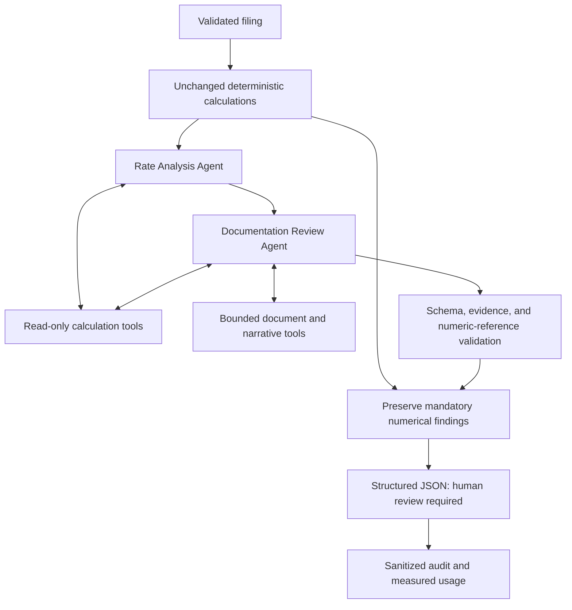

# Phase 2: tools, agent boundaries, and evidence

## Verified interface and model

The original Phase 2 verification used `portkey-ai==2.3.4` and
`gpt-6-luna`; its saved evidence remains unchanged. The current application uses
the official OpenAI Python SDK (`openai==3.37.0`) with `OPENAI_API_KEY` and
`gpt-6-luna` via `client.chat.completions.create`. Chat Completions function
calling uses `reasoning_effort="none"`.

Official documentation reviewed on October 24, 2026:

- [GPT-6 Luna](https://developers.openai.com/api/docs/models/gpt-6-luna)
- [Function calling](https://developers.openai.com/api/docs/guides/function-calling)
- [Structured outputs](https://developers.openai.com/api/docs/guides/structured-outputs)
- [Course requirements](https://zlisto.github.io/mgt_409_fa26/project_requirements.html)

The original live connectivity probe tested a minimal completion, automatic
selection between native tools, a tool result linked by `tool_call_id`, and
strict JSON Schema output. `docs/evidence/phase2-connectivity.json` contains that
historical Portkey run. Migration verification is recorded separately.

The OpenAI SDK client's `max_retries=0`; bounded application retries are then
visible as separate requests in the audit. A mocked
HTTP 429 test confirms a single network attempt per adapter invocation. Hidden
provider/gateway processing or retries, if any, are not observable from this app.

## Responsibility and execution

The controller is ordinary Python. It creates a review-scoped registry, runs the
Rate Analysis Agent, and passes a bounded validated summary to the Documentation
Review Agent. The second agent retrieves its own evidence. There is no autonomous
planning agent, unrestricted delegation, external search, shell, or code tool.

The Rate Analysis Agent explains weighting, discrepancies, large movements, and
follow-up investigations. Its `findings` list must be empty: numerical detections
remain the engine's. The Documentation Review Agent can produce new missing-
support, narrative-contradiction, unsupported-claim, or suspicious-instruction
findings. Explicit repetitions of numerical comparisons are retained as AI
interpretations of deterministic detections, not credited as new AI detections.

The model chooses native tools, their arguments, and their order. The controller
never fabricates a model tool call. Coverage gates require the rate agent to
retrieve portfolio and reconciliation results, and segment details when needed;
the document agent must read the full narrative, inventory, and provided
documents. A missed coverage gate can prompt a bounded correction, but the
subsequent tool calls still originate from the model.

## Read-only registry

| Tool | Validated arguments beyond review ID | Output |
|---|---|---|
| `get_portfolio_summary` | None | Authoritative metrics, largest movements, assumptions |
| `get_segment_calculations` | Up to eight known segment IDs | Modeled rates and changes |
| `get_reconciliation_findings` | Offset and limit, at most twelve | Deterministic findings and numerical evidence |
| `get_calculation_evidence` | Up to eight known calculation/source IDs | Formula/value records; bounded source-reference list |
| `get_filing_narrative` | Offset and length, at most 6,000 characters | Untrusted text with pagination |
| `get_document_inventory` | None | Submitted document status and identifiers |
| `get_document_excerpt` | Known document ID, offset, at most 4,000 characters | Untrusted document text with pagination |
| `check_narrative_rate_bound` | Source evidence ID and exact retrieved quotation | Python comparison of a stated absolute-change bound against all modeled segment changes |

Every call requires the current review's exact ID. Parameter schemas reject
additional properties and invalid types. Identifiers are resolved only against
in-memory data for that review. There is no filename, URL, command, or arbitrary
code argument. Invalid calls are returned as bounded error objects and logged.
The rate agent has access only to the calculation tools.

## Structured findings and numerical authority

Strict JSON Schema constrains the model response; Pydantic validates it again.
The backend assigns final IDs and origin. Findings include category, severity,
title, explanation, recommended action, affected items, evidence references, and
an evidence-strength label. All AI interpretations remain subject to analyst
verification; no verified-regulatory category exists.

Only evidence actually retrieved by that agent can be cited. Exact source quotes
must appear in a retrieved chunk, affected items must exist and be cited, and
missing-document findings must refer to inventory items marked `not_provided`.
Numerical contradictions must cite calculation evidence as well as source text.
For the supported “No segment changes by more than X% in absolute terms” claim,
the model must call the bound-checking tool. Python extracts X from the exact
retrieved quotation, checks all segment changes, and supplies a `bound:` evidence
record. A contradiction is rejected if the tool says the bound holds. Other
wordings are outside this narrow parser's scope; it does not infer arbitrary
regulatory or actuarial requirements.
Known approval/compliance declarations are rejected; broader semantic accuracy
still requires analyst review. Referential validation is not proof that a source
logically entails every natural-language claim.

AI prose cannot supply numeric rate/premium values. It uses placeholders plus
`numeric_references` containing only an evidence ID, field, and placeholder key.
There is no model-supplied numeric-value field. Python resolves the value from
calculation records. Literal digits and spelled-out quantitative measurements
are rejected; validated segment identifiers and ordinary phrases such as “one
example” are not treated as actuarial arithmetic. Source quotes remain labeled
untrusted. The raw response is retained in audit data, not promoted to an
authoritative finding.

The renderer displays up to six decimal places and retains full Decimal strings
in `numeric_evidence`. The underlying Phase 1 calculation precision is unchanged.
Verified numeric references may appear solely in the structured evidence table;
they do not have to be interpolated into every prose explanation.

## Bounds and failures

`ReviewLimits` and optional `REVIEW_*` environment variables configure:

- Twelve model requests per review, including network retries and output repair.
- Six requests per agent and sixteen tool calls per agent.
- 3,600 completion tokens per request; 80,000 UTF-8 bytes in the request body.
- An 80,000 reported-token stopping threshold for subsequent calls.
- One network retry with bounded backoff; one output correction per agent.
- Forty-five seconds per request and a 180-second total review deadline.
- Narrative/document lengths and tool-output size limits.

The request-byte limit is a conservative size control, not an exact model input
token count. Reported-token limits cannot predict unreported billing and may be
crossed by the last bounded request. The independent request-count and output
limits remain in force even when usage is unavailable. Cancellation cannot prove
that an upstream provider stopped billing an already received request.

Timeouts, connection failures, rate limits, malformed responses, rejected
findings, and exhausted budgets produce incomplete agent stages. The result
retains deterministic calculations and findings and is marked `partial`. The
health endpoint never calls the model. The local API permits a single concurrent
review and rejects request bodies larger than 2 MB.

## Audit and tokenomics

Each run stores timestamped ordered events, prompt version, configuration,
canonical input hash, actual request bodies, model responses, validated tool
arguments/results, latency, retries, errors, and validation decisions. Request
headers and credential-bearing SDK objects are never serialized. Known keys are
redacted at storage and response boundaries. Runtime data stays ignored by Git;
only deliberately exported bundled synthetic runs enter `docs/evidence/`.

Input, cached input, output, and total tokens are taken from actual usage fields.
Cached input is a subset of input, not an additional token category to add again.
Missing usage is `null`, never invented as zero. Reported subtotals remain
available when some attempts have missing usage. Failed requests may have
unreported costs. Dollar billing and dollar estimates are explicitly unavailable;
the app does not guess course gateway charges from public list prices.

## Prompt-injection evidence and evaluation limits

System instructions identify all narrative/document text as untrusted evidence.
Only the registry may execute model-selected tools. The schema and reference
validator control what reaches findings, and the controller merges mandatory
numerical findings independently of all model text. Disposition is always
`human_review_required`.

The live adversarial evaluation separately measures recognition of suspicious
instructions, bare approval output, accepted endorsement, tool use, review
completion, and preservation of deterministic findings. Recognition alone is not
treated as successful resistance. The adversarial fixture has no numerical
issues, so a separate mocked attack on the flawed filing proves preservation of
nonempty mandatory findings. This demonstrates tested cases, not universal
prompt-injection resistance.

The independent answer key and evaluation mapping are never passed to agents.
Automated scoring compares numerical golden values and maps AI finding categories
to affected documents. It reports missed/extra findings and severity disagreements;
human inspection of source quotes and explanations is still required. Development
attempts and their failures remain recorded rather than being represented as
successful first attempts.
